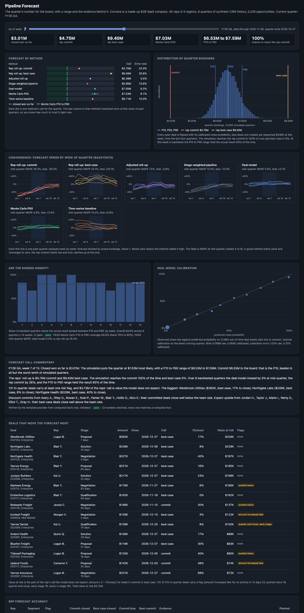

# Pipeline Forecast

Quarterly sales forecasting for Corvane, a made-up B2B SaaS company with 40 account executives in 5 regions. It produces the number a CRO commits to the board, with a range and the evidence behind it instead of gut feel. A seeded simulator writes 8 quarters of CRM history (stage changes, close date pushes, amount changes, the forecast category each rep sets, activities) for 5,229 opportunities, with reps who sandbag, reps with happy ears, and reps who call it straight. Five forecast methods run as of every Monday of the quarter, every past quarter is replayed week by week to score them, rep calls are checked against history, and a FastAPI service serves the forecast, backtests, rep accuracy, deal risk, and a CRO commentary whose every number is checked against the computed facts.



## Results

Six past quarters (FY25 Q2 to FY26 Q3) replayed week by week. Each cell is MAPE against the quarter's actual closed won bookings, using only what was in the CRM on that Monday.

| Method | Wk 1 | Wk 3 | Wk 5 | Wk 7 | Wk 9 | Wk 11 | Wk 13 | Mid-quarter MAPE | Mid-quarter bias |
|---|---:|---:|---:|---:|---:|---:|---:|---:|---:|
| Rep roll-up: commit | 62.8% | 49.9% | 40.4% | 24.3% | 14.1% | 9.8% | 7.3% | 26.3% | -26.3% |
| Rep roll-up: best case | 12.5% | 17.6% | 19.8% | 30.6% | 22.3% | 17.8% | 7.5% | 25.1% | +25.1% |
| Adjusted roll-up | 22.3% | 12.8% | 14.1% | 5.5% | 4.9% | 9.9% | 10.3% | 7.5% | -4.8% |
| Stage-weighted pipeline | 37.2% | 26.5% | 19.3% | 10.6% | 6.6% | 6.4% | 8.0% | 12.0% | -12.0% |
| **Deal model** | **5.6%** | **5.8%** | **4.9%** | 6.2% | 5.3% | **3.7%** | **3.0%** | **5.0%** | +3.7% |
| Monte Carlo P50 | 5.7% | 5.7% | 4.8% | 6.1% | 5.2% | 3.5% | 3.2% | 4.9% | +3.4% |
| Time-series baseline | 13.4% | 14.7% | 13.6% | 10.0% | 6.8% | 8.4% | 6.4% | 10.3% | +5.8% |

Mid-quarter is weeks 5 to 9. The rep commit runs 26% low at mid-quarter and only converges in the last weeks; best case runs 25% high. Correcting each rep's call by their history (adjusted roll-up) cuts the error to 7.5%. The deal model is within about 6% from week 1, because it scores every open deal, including the ones reps have not called yet, and adds the deals that do not exist yet but will close this quarter.

- **Ranges.** The Monte Carlo P10 to P90 range contained the actual result in 84.6% of the 78 backtest weeks (target 80%).
- **Calibration.** On 27,964 out-of-time deal weeks: Brier 0.0698 raw, 0.0695 after isotonic calibration; expected calibration error 1.02% raw, 0.70% calibrated.
- **Rep flags.** 14 reps flagged. 13 match the hidden tendency the simulator planted: 8 of 9 over-optimistic reps and 5 of 7 sandbaggers, with 1 false alarm among 24 accurate reps. The two missed sandbaggers sell Enterprise and had only 8 and 16 best case deals in 8 quarters, so a binomial test cannot separate them from noise.
- **Current quarter (FY26 Q4, week 7).** Won to date $3.01M. Reps call $4.75M commit and $9.40M best case. Monte Carlo P10 $6.53M, P50 $7.03M, P90 $7.59M. 131 of 315 in-quarter deals carry a risk flag; $3.73M of the reps' call is value the model does not expect.

CI fails the build if interval coverage leaves 70% to 90%, or if the deal model's mid-quarter MAPE is not better than the rep roll-up. Full numbers: [reports/summary.md](reports/summary.md) and [reports/backtest.json](reports/backtest.json).

## Why

Most forecast calls are a roll-up of what reps say, adjusted by a sales leader's gut. Reps are not neutral: some commit every deal they like and miss, some hide deals in best case so they can beat their number, and the leader learns who is who over years. The CRM already holds the evidence: how long deals sit in a stage, how many times the close date moved, whether anyone has talked to the buyer lately, and how each rep's calls turned out before. This repo shows the forecast a revenue operations team would build from that: several methods side by side, a range instead of a point, each method's track record at this week of the quarter, the reps whose calls need a discount, and the deals that decide the quarter.

## Architecture

```
 generator (seeded)               snapshots                       methods (as of each Monday)          serving
 ┌─────────────────────────┐     ┌──────────────────────────┐    ┌──────────────────────────────┐    ┌───────────────────────┐
 │ 40 reps, 5 regions      │     │ replay field history to  │    │ 1 rep roll-up (commit, best) │    │ FastAPI               │
 │ hidden: tendency, skill │     │ any day: stage, amount,  │    │ 2 stage-weighted pipeline    │    │ /api/forecast?week=   │
 │ deals: hidden true p,   │────▶│ close date, category,    │───▶│ 3 deal model (HGB+isotonic)  │───▶│ /api/backtest         │
 │ outcome, cycle          │     │ days in stage, pushes,   │    │ 4 Monte Carlo P10/P50/P90    │    │ /api/reps, /api/risk  │
 │ weekly walk writes the  │     │ amount changes, activity │    │ 5 time-series baseline       │    │ /api/commentary       │
 │ CRM audit log           │     │ recency                  │    │ + adjusted roll-up by rep    │    │ /healthz, /metrics    │
 └─────────────────────────┘     └──────────────────────────┘    └──────────────────────────────┘    │ plain HTML/JS UI      │
                                         backtest: replay quarters 2 to 7, fit on quarters before   └───────────────────────┘
```

| Piece | File |
|---|---|
| Fiscal calendar, 13 week quarters | [src/pipecast/fiscal.py](src/pipecast/fiscal.py) |
| Synthetic CRM, reps, hidden tendencies | [src/pipecast/generator.py](src/pipecast/generator.py) |
| Snapshot reconstruction from field history | [src/pipecast/snapshots.py](src/pipecast/snapshots.py) |
| Roll-up, stage weights, time series, new pipeline | [src/pipecast/methods.py](src/pipecast/methods.py) |
| Deal model and calibration | [src/pipecast/model.py](src/pipecast/model.py) |
| Monte Carlo | [src/pipecast/montecarlo.py](src/pipecast/montecarlo.py) |
| Backtest, MAPE, bias, coverage, CI gate | [src/pipecast/backtest.py](src/pipecast/backtest.py) |
| Rep accuracy, flags, adjusted roll-up | [src/pipecast/reps.py](src/pipecast/reps.py) |
| Deal risk flags, value at risk | [src/pipecast/risk.py](src/pipecast/risk.py) |
| Commentary and number validator | [src/pipecast/commentary.py](src/pipecast/commentary.py) |
| API, JSON logs, Prometheus metrics, UI | [src/pipecast/app.py](src/pipecast/app.py), [logs.py](src/pipecast/logs.py), [metrics.py](src/pipecast/metrics.py), [static/index.html](src/pipecast/static/index.html) |

**The CRM.** Three segments: SMB (median $18K, 40 day cycle), Mid-Market ($55K, 75 days), Enterprise ($160K, 130 days). Each deal gets a hidden win propensity from segment, source (inbound, outbound, partner, expansion), rep skill, a shared quarter shock, and noise. The simulator walks each deal week by week and logs what a CRM audit trail would show. Reps underestimate cycles and park close dates at quarter end, so close dates get pushed. Lost deals stall in a stage and go quiet 3 to 5 weeks before they are marked lost; some get a late amount increase first. Won deals bunch at quarter end and often take a discount to sign. Every week the rep sets a forecast category from what they believe: optimistic reps commit early, at Qualification, on deals that will not close; sandbaggers keep deals they will win in best case until Negotiation. The forecasting code never reads the hidden columns.

**Snapshots.** Forecasts need the pipeline as it looked on a past Monday, not as it looks today. Snapshots replay the audit log: the last value of each field logged before the as-of day, plus days in stage, number of pushes, amount change since creation, a late increase flag, activities in the last 14 days, and days since the last activity. Any day can be rebuilt (daily snapshots on demand); the backtests use the 13 Mondays of each quarter.

**Methods.** Each one adds an estimate for open deals to what has already closed.
1. *Rep roll-up*: commit is closed plus open deals the reps marked commit; best case adds deals marked best case.
2. *Stage-weighted pipeline*: open in-quarter amount times the dollar-weighted share of in-quarter pipeline at that stage that closed in the quarter, over the last four quarters.
3. *Deal model*: scikit-learn gradient boosting on 18 features (stage, amount, segment, source, rep's category, days in stage, age, pushes, amount change, late increase, activity in 14 days, days since activity, activity rate, close date in quarter, days to close date, days left, week). One row per open deal per Monday; the label is closed won inside that quarter. A model for quarter q trains on quarters before q and fits isotonic calibration on the latest of them. The forecast is the sum of probability times amount, plus expected bookings from deals not created yet (from the last four quarters at the same week).
4. *Monte Carlo*: 10,000 simulated quarters, each flipping every open deal with its calibrated probability and drawing the not-yet-created amount. Reported as P10, P50, P90, the chance to reach the rep commit, and a histogram.
5. *Time-series baseline*: Holt's linear trend on past quarter totals, minus the share of a quarter that is usually closed by this week.

Plus the *adjusted roll-up*: team close rates by forecast category and stretch of the quarter, times each rep's observed over expected wins in that category, shrunk toward 1 with 25 pseudo deals.

**Rep accuracy.** For each past quarter, each in-quarter deal gets the highest call its rep made between weeks 2 and 12. A rep is over-optimistic when their commits close significantly below their segment's team rate, and sandbagging when their best case deals close significantly above it (one-sided binomial test, p < 0.05). The table also shows mid-quarter commit bias against actual bookings and how many quarters the rep beat their commit.

**Deal risk.** Flags: pushed twice; stuck in stage beyond the 90th percentile of past stints for that stage and segment; no activity in 14 days; amount increased in the last 21 days while in Proposal or Negotiation; close date in the last week of the quarter while still in Discovery or Qualification. Deals are ranked by value at risk: amount times (1 minus model probability) for deals in commit or best case, the part of the reps' call the model does not expect.

**Commentary.** The offline template provider (default) or Claude (`PIPECAST_LLM_PROVIDER=claude`, model `claude-opus-5-5`) writes the call from a facts dict of formatted numbers. The validator extracts every number from the text and accepts it only if it matches a computed fact at the precision shown ("$7.0M" matches 7,034,500; "85%" never matches a plain 85). If Claude's text fails, the API returns the template text and lists what was rejected.

## How to run

```bash
cd pipeline-forecast
uv sync --python 3.12
make eval          # full backtest (about 30 s), writes reports/ and caches data/forecaster.pkl
make run           # API and UI on http://127.0.0.1:8854
```

Without the cache, `make run` builds everything on first start. `PIPECAST_WEEK` sets the default week, `PIPECAST_RATE_SCALE` scales deal flow, `PIPECAST_CACHE` moves the cache.

```bash
curl localhost:8854/healthz
curl "localhost:8854/api/forecast?week=7"     # all methods, Monte Carlo summary and histogram
curl localhost:8854/api/backtest              # error by method and week, coverage, calibration, gate
curl localhost:8854/api/reps                  # per rep accuracy, flags, evidence
curl "localhost:8854/api/risk?limit=10"       # deals ranked by value at risk, with flags
curl localhost:8854/api/commentary            # CRO call text plus validator result
curl localhost:8854/metrics
```

For Claude commentary: `uv sync --extra claude`, set `ANTHROPIC_API_KEY` (see `.env.example`), then `curl "localhost:8854/api/commentary?provider=claude"`.

`make gate` runs the backtest and exits 1 if the gate fails. Docker is not installed on the development machine, so the `Dockerfile` (multi-stage, non-root, HEALTHCHECK) is built and smoke tested in GitHub Actions only. Everything runs without it through `uv`.

## Tests

73 tests, about 20 seconds: `make test`. The suite builds one engine with half the deal flow and shares it.

- Snapshots: a hand-written two-deal history checked field by field, events on the as-of day stay invisible, a slow event-by-event replay matches the vectorized snapshot on 45 random (deal, day) pairs, bookings match the hidden truth, no hidden column leaks.
- Generator: seeding, team shape, the hidden propensity drives outcomes, pushes always move later, activities fall inside each deal's life, fiscal calendar.
- Methods: stage conversion rates and stage-weighted forecast by hand, roll-up by hand, Holt on a straight line, quarter shape, rates rise with stage.
- Deal model: the time split refuses future or too few quarters, scrambling every event after the as-of day leaves the features unchanged, out-of-time Brier beats the base rate, ECE and Brier by hand, isotonic fixes an overconfident score.
- Monte Carlo: P10, P50, P90 against the binomial distribution, mean and variance against the analytic sum, certain deals, seeding.
- Backtest: MAPE, bias, and coverage math, row accounting, summary recomputed from rows, convergence, model beats roll-up, gate pass and fail.
- Reps: planted tendencies detected with few false alarms, evidence text, adjusted roll-up shrinkage by hand.
- Risk: each flag alone, stage norms by hand, value at risk.
- Commentary: validator accepts facts and their roundings, rejects invented numbers, keeps percents apart, ignores labels like P10 and FY26; template passes on real facts; fake Claude client passes, and a made-up number falls back to the template.
- API end to end: every endpoint, week validation, history cut at the as-of day, metrics.

## Production notes

- **Data.** Snapshots would come from the CRM's field history tables loaded nightly into a warehouse, with a daily snapshot table materialized for speed. Activity would come from email and calendar sync, which is noisier than the simulator.
- **Retraining.** Retrain the deal model at each quarter close and recalibrate monthly. Track backtest error by week as a dashboard metric, so a drop in accuracy shows up before the board call does.
- **Correlation.** Deals are simulated as independent. Real quarters share shocks (a budget freeze, a competitor launch), so production ranges should add a quarter-level factor or bootstrap past quarter residuals; the coverage check here is the guard.
- **Rep flags.** Use them for coaching and for weighting calls, not for performance reviews. Thin books (Enterprise) need more quarters or pooling across similar reps before a flag means anything.
- **Commentary.** Keep the number validator in front of any model output that reaches a board deck, and log every rejected draft.

## License

MIT. See [LICENSE](LICENSE).
